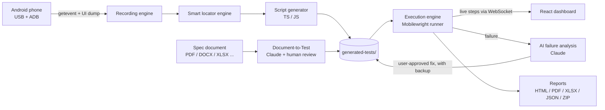
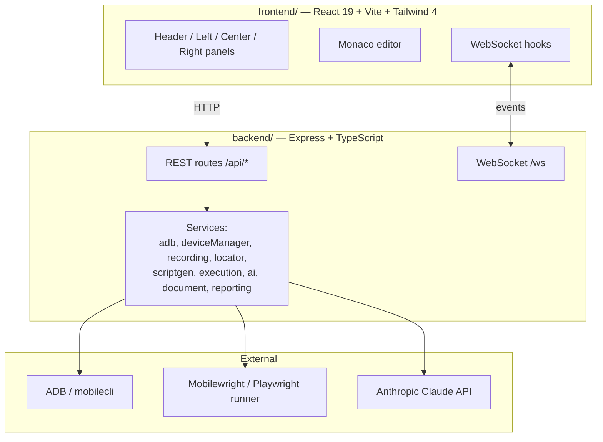

<div align="center">

# AI Android Automation Studio

**Record on a real Android phone. Get clean test scripts. Run them. Let AI explain the failures.**

A web-based platform that turns real touch interactions on a physical Android device into
maintainable [Mobilewright](https://www.npmjs.com/package/mobilewright) test scripts, runs them with
live step-by-step progress, analyzes failures with Claude, and exports professional reports.


-3DDC84?logo=android&logoColor=white)

</div>

---

## Table of contents

- [Why this exists](#why-this-exists)
- [Features](#features)
- [How it works](#how-it-works)
- [Architecture](#architecture)
- [Tech stack](#tech-stack)
- [Getting started](#getting-started)
- [Configuration](#configuration)
- [Usage walkthrough](#usage-walkthrough)
- [API reference](#api-reference)
- [Project structure](#project-structure)
- [Design principles](#design-principles)
- [Testing & quality](#testing--quality)
- [Troubleshooting](#troubleshooting)
- [Known limitations](#known-limitations)
- [Roadmap ideas](#roadmap-ideas)
- [Contributing](#contributing)

---

## Why this exists

Writing mobile UI tests by hand is slow, and record-and-playback tools usually produce brittle,
coordinate-based scripts that break on the next UI change. Mobilewright (a Playwright-style framework for
mobile) gives a great *automation* API (tap, swipe, locate, assert) but has **no built-in way to record what
a human just did**.

This project fills that gap and wraps the whole QA loop in one dashboard:

> **Record → Generate → Execute → Diagnose → Report**

No Android Studio and no emulator are required. Only a USB-connected phone and ADB.

## Features

| Area | What you get |
| --- | --- |
| **Device manager** | Real device detection via `adb` (`connected` / `unauthorized` / `disconnected` / `adb-missing`), model, manufacturer, Android version and API level, polled live. |
| **Recording engine** | Captures real touches from `adb shell getevent`, classifies them into tap / long-press / swipe / scroll / back / text input, and correlates each with the on-screen UI tree. |
| **Smart locator engine** | Ranks every candidate locator by stability and checks **uniqueness against the live screen**. Priority: `getByTestId` → `getByLabel` → `getByRole` → `getByText` → `getByPlaceholder` → `getByType` → XPath → raw coordinates (last resort). |
| **Script generator** | Produces clean **TypeScript or JavaScript** Mobilewright tests with `test.step()` per action, auto-generated `toBeVisible()` assertions, auto-detected `bundleId`, and credentials routed through `process.env` instead of being hardcoded. |
| **Monaco editor** | Edit generated scripts in-browser (self-hosted Monaco, syntax highlighting, save back to disk). |
| **Execution engine** | Runs scripts one at a time on the device with **live per-step status over WebSocket**, progress %, logs, stop/retry, and automatic failure screenshots. |
| **AI failure analysis** | Sends the failed step, error, logs and device info to Claude and returns a summary, ranked likely causes, and a suggested fix. Fixes are **never auto-applied** and the original script is backed up first. |
| **Document-to-Test** | Upload a spec (`PDF`, `DOCX`, `XLSX`, `CSV`, `TXT`, `MD`, `JSON`), have Claude propose scenarios and test cases, **review and approve** each one, then render a script. |
| **Live Inspector** | Embeds Mobilewright's inspector to browse the live UI hierarchy of the connected device. |
| **Reporting** | Download any execution as **HTML, PDF, XLSX, JSON or ZIP** (HTML + JSON + screenshots). |

## How it works



**Recording in detail.** Mobilewright and `mobilecli` can *drive* a device but cannot *observe* one. The
recorder therefore parses raw Linux evdev events from `adb shell getevent -lt`, detects gestures (handling
both Type A and Type B multitouch protocols), scales raw touch coordinates to screen pixels, then matches
each gesture to an element in a UI snapshot taken before and after it. Text entry is inferred by diffing
editable fields between snapshots, since soft-keyboard keystrokes are not observable.

## Architecture



Key backend design choices:

- **One responsibility per file.** Services are small and dependency-injected (e.g. `ExecutionQueue`,
  recording `session`) so the logic is unit-testable without a device.
- **Safe process execution.** `adb` is invoked with `execFile`, never through a shell.
- **Custom Playwright reporter** (`execution/liveReporter.ts`) emits step events as marker-prefixed JSON on
  stdout, which the runner parses and broadcasts live to the UI.
- **One device, one run at a time.** The execution queue is strictly sequential.
- **File-based persistence.** Recordings, execution sessions and document sessions are stored as JSON on
  disk. There is no database to set up.

## Tech stack

| Layer | Technology |
| --- | --- |
| Frontend | React 19, Vite 8, TypeScript, Tailwind CSS 4, Monaco Editor, oxlint |
| Backend | Node.js 20+, Express 4, TypeScript, `ws`, `multer`, ESLint, Vitest, Supertest |
| Automation | [`mobilewright`](https://www.npmjs.com/package/mobilewright) + `@mobilewright/test` (Playwright-based), `mobilecli`, ADB |
| AI | [`@anthropic-ai/sdk`](https://www.npmjs.com/package/@anthropic-ai/sdk) with structured (JSON-schema) output |
| Documents | `pdf-parse`, `mammoth`, `exceljs`, `csv-parse` |
| Reports | `pdfkit`, `exceljs`, `archiver` |
| Monorepo | npm workspaces, `concurrently`, Prettier |

## Getting started

### Prerequisites

- **Node.js 20+** and npm
- **Android SDK Platform-Tools (ADB)** on your `PATH`. Android Studio is *not* required.
  ```bash
  adb version
  ```
- A **physical Android device** connected over USB with **USB debugging** enabled (Developer options) and
  authorized for your computer.
- *(Optional)* an **Anthropic API key** to enable AI failure analysis and Document-to-Test.

### Install and run

```bash
git clone <your-repo-url>
cd <your-repo-folder>

npm install
cp .env.example .env        # Windows PowerShell: Copy-Item .env.example .env
npm run dev
```

| Service | URL |
| --- | --- |
| Dashboard | http://localhost:5173 |
| API health | http://localhost:4000/api/health |
| WebSocket | `ws://localhost:4000/ws` |

Run them separately with `npm run dev:backend` and `npm run dev:frontend`.

### Verify your environment

```bash
adb devices                # your phone should be listed as "device", not "unauthorized"
npx mobilewright doctor    # checks mobilecli + ADB (Android Studio items are optional)
```

## Configuration

All settings live in `.env` (copied from [.env.example](.env.example)). **Never commit `.env`.**

| Variable | Default | Purpose |
| --- | --- | --- |
| `PORT` | `4000` | Backend port |
| `CORS_ORIGIN` | `http://localhost:5173` | Allowed frontend origin |
| `ADB_PATH` | `adb` | Path to the adb binary |
| `ANTHROPIC_API_KEY` | *(empty)* | Enables AI features. Leave blank to disable them |
| `ANTHROPIC_MODEL` | see `backend/src/config/env.ts` | Claude model used for AI features |
| `RECORDINGS_DIR`, `GENERATED_TESTS_DIR`, `REPORTS_DIR`, `SCREENSHOTS_DIR`, `UPLOADS_DIR` | repo-relative | Where runtime artifacts are stored |
| `LOG_LEVEL` | `info` | Structured log verbosity |

Generated scripts read credentials from the environment (for example `TEST_PASSWORD`) so secrets never end
up in a script file.

## Usage walkthrough

1. **Connect** your phone and confirm the header shows a real *connected* state.
2. **Record**: click *Start Recording*, use the app on the phone, then *Stop*. Actions and their best locator
   appear live in the right panel.
3. **Generate**: choose *Generate TS* or *Generate JS* on the recording. The script opens in the Monaco editor.
4. **Edit** if needed and save. Previous versions are backed up before AI changes.
5. **Execute**: run one script or *Run All*. Watch each step flip ✓ in real time.
6. **Diagnose**: on a failure click *AI Analyze Failure*, review the suggested fix, then explicitly
   *Apply AI Fix* (a backup is created first).
7. **Report**: when the run finishes, download HTML / PDF / XLSX / JSON / ZIP from the bottom bar.

**From a spec instead of a recording:** upload a document in the *Documents* section, click *Analyze with AI*,
tick the test cases you approve, then generate TS or JS.

Example of a generated script:

```ts
import { test, expect } from '@mobilewright/test';

test.use({ bundleId: 'com.example.app' });

test('Login flow', async ({ screen }) => {
  await test.step('Tap "Sign in"', async () => {
    await screen.getByText('Sign in').tap();
  });
  await test.step('Enter password', async () => {
    await screen.getByLabel('Password').fill(process.env.TEST_PASSWORD ?? '');
  });
  await test.step('Verify "Welcome" is visible', async () => {
    await expect(screen.getByText('Welcome')).toBeVisible();
  });
});
```

## API reference

Base path: `/api`

| Area | Endpoints |
| --- | --- |
| Health | `GET /health` |
| Device | `GET /device/status`, `POST /device/disconnect` |
| Automation | `GET /automation/mobilewright-status` |
| Recording | `POST /recording/start`, `POST /recording/stop`, `GET /recording`, `GET /recording/active`, `GET /recording/:id` |
| Scripts | `POST /scripts/generate`, `GET /scripts`, `GET /scripts/:language/:fileName`, `PUT /scripts/:language/:fileName` |
| Execution | `POST /execution/run`, `POST /execution/stop`, `GET /execution`, `GET /execution/active`, `GET /execution/:id` |
| AI | `POST /ai/analyze-failure`, `POST /ai/apply-fix` |
| Documents | `POST /documents/upload`, `GET /documents`, `GET /documents/:id`, `POST /documents/:id/analyze`, `PUT /documents/:id/scenarios`, `POST /documents/:id/generate-script` |
| Reports | `GET /reports`, `GET /reports/:id/:format` (`html` \| `pdf` \| `xlsx` \| `json` \| `zip`) |
| Inspector | `GET /inspector/inspect` |
| System | `POST /system/reset` (destructive, wipes recordings, scripts and reports) |

**WebSocket events** (`ws://localhost:4000/ws`, payload `{ event, payload }`): `recording:started`,
`recording:action`, `recording:stopped`, plus live execution events (test, step and run begin/end).

## Project structure

```
.
├── frontend/                  React dashboard (Vite + Tailwind)
│   └── src/
│       ├── api/               Typed API clients
│       ├── components/        layout, execution, documents, inspector, common
│       ├── hooks/             WebSocket hooks (recording, execution)
│       └── types/             Shared domain types
├── backend/                   Express API + automation services
│   └── src/
│       ├── config/            env + structured logger
│       ├── routes/            REST endpoints
│       ├── services/
│       │   ├── adb.ts, deviceManager.ts
│       │   ├── recording/     getevent parser, gesture detector, UI tree, session
│       │   ├── locator/       locator ranking + role map
│       │   ├── scriptgen/     generator, assertions, credentials, versions
│       │   ├── execution/     runner, queue, live reporter, manager
│       │   ├── ai/            Claude client + prompts
│       │   ├── document/      parsers, analyzer, script renderer, store
│       │   └── reporting/     html / pdf / xlsx / zip / summary
│       └── websocket/         live event broadcast
├── docs/PHASES.md             Detailed build log, per-phase verification notes
├── mobilewright.config.ts     Mobilewright runner config
├── generated-tests/           Generated scripts (git-ignored, runtime)
├── recordings/ reports/ screenshots/ videos/ uploads/ logs/   Runtime artifacts (git-ignored)
└── CLAUDE.md                  Rules for AI coding assistants
```

## Design principles

These rules are enforced across the codebase (see also [CLAUDE.md](CLAUDE.md)):

1. **Never fake device state.** *Connected* comes only from a real `adb` check. Otherwise it is `unknown`.
2. **Never fake results.** A script is only reported passed or failed after it actually ran.
3. **Never swallow errors.** Failures surface in logs and the UI.
4. **No Android Studio dependency.** Only ADB / Platform-Tools.
5. **Semantic locators first.** Coordinates are the last fallback.
6. **No hardcoded secrets.** Environment variables only, masked in logs.
7. **AI never edits silently.** Fixes need explicit approval and a backup.
8. **No auto-installing system software.** The tool detects and informs.

Security-relevant details: path-traversal protection on script file names, a whitelist of safe locator
shapes before any AI-suggested locator is written into a script, HTML escaping in reports, and upload size
limits (20 MB).

## Testing & quality

```bash
npm run test     # backend unit + route tests (Vitest, 200 tests)
npm run lint     # ESLint (backend) + oxlint (frontend)
npm run build    # type-check and build both workspaces
npm run format   # Prettier
```

The recording, locator, script-generation, execution-queue, document and reporting logic is covered by
device-independent unit tests using realistic fixtures (real `getevent` and `adb devices` output formats,
synthetic UI trees, real XLSX/PDF/ZIP buffers).

## Troubleshooting

| Symptom | Fix |
| --- | --- |
| Header shows **adb-missing** | Install Platform-Tools and add it to `PATH`, or set `ADB_PATH` |
| Device shows **unauthorized** | Unlock the phone and accept the *Allow USB debugging* prompt |
| Device shows **disconnected** | Check cable and USB mode, then run `adb devices` |
| *No tests found* when running | Scripts must be under `generated-tests/`; the runner filters by relative path |
| AI buttons return *ANTHROPIC_API_KEY is not set* | Add the key to `.env` and restart the backend |
| Screenshots not loading in dev | The Vite dev server proxies `/screenshots` to the backend on port 4000 |

## Known limitations

- **Android only** and **one device at a time**; runs are sequential.
- Recording relies on `adb shell getevent` and `mobilecli dump ui`. Output formats vary between OEMs, so
  some devices may need tuning.
- Soft-keyboard text is inferred from UI diffs, so captured text can occasionally be missing
  (generated as a `TODO` rather than guessed).
- Document-to-Test locators are AI guesses with no live UI to validate against. That is why every test case
  needs human approval and nothing runs automatically.
- Persistence is JSON files, which suits a single-user local tool but not multi-user hosting.
- There is no authentication, so run it on `localhost` only.

## Roadmap ideas

- iOS support through Mobilewright
- Multi-device parallel execution
- CI mode (headless CLI run and report)
- SQLite/PostgreSQL persistence
- Visual regression comparison between runs
- Auth and multi-user mode

## Contributing

1. Fork and create a feature branch.
2. Keep files small and modular, with one responsibility each.
3. Add tests for new logic and run `npm run lint && npm run test && npm run build`.
4. Open a pull request describing the change and how you verified it.

Please read [CLAUDE.md](CLAUDE.md) first and respect the design principles above.

## Acknowledgements

Built on [Mobilewright](https://www.npmjs.com/package/mobilewright), Playwright, ADB, React, Vite, Monaco
Editor and the Anthropic Claude API.
